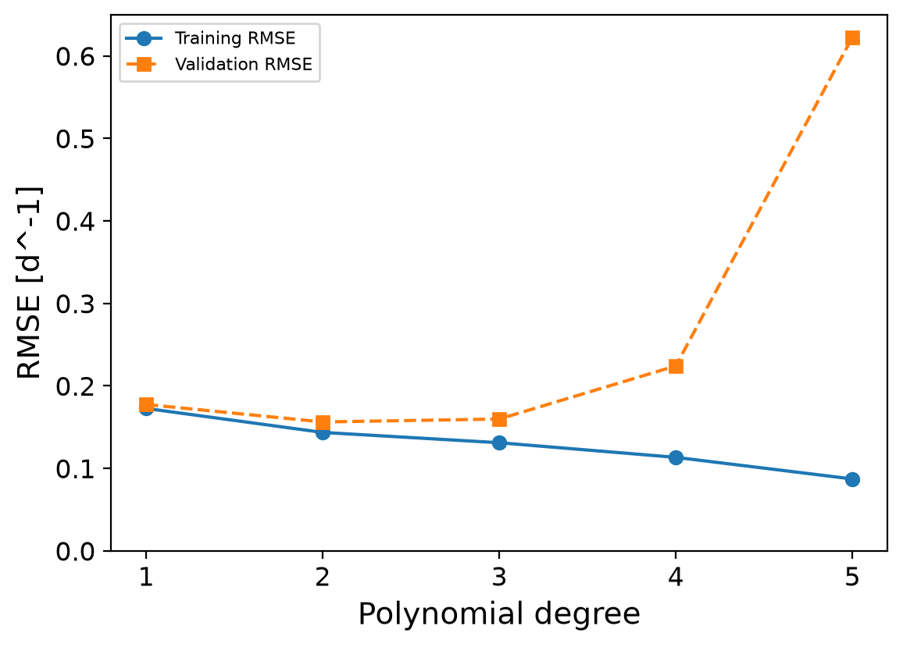

# Machine Learning Model Validation for Predicting Growth Rate
In this project, this code is suppose to evaluate different machine learning models, such as linear regression, polynomial regression, and K Nearest Neighbor (KNN) algorithm by comparing RMSE scores and validation curves of each model, with all models were developed using hyperparameter optimization. This attempt to solve which model is best to be used for predicting cell growth under changing temperatures, pH, lactate concentrations and glucose concentrations. 

## Highlights
* Analyzed variables affecting cell growth rates
* Developed code to process and sort fermentation data
* Evaluated machine learning models using cross-validation and RMSE
* Optimized hyperparameters to improve prediction accuracy
* Compared machine learning algorithms and their limitations

## Environment
The following coding language, tools and libraries used for this project are:
* Python (ver 3.13.5) - Runs code and analysis
* Matplotlib (ver 2.3.5) - Creates graphs
* NumPy (ver 2.3.5)  - Supports numerical calculations and array operations
* pandas (ver 2.2.3) - Loads and organizes CSV datasets
* scikit-learn (ver 1.8.0) - builds and evaluates linear, polynomial, KNN regression models. Does size 5-fold cross-validation with training data.

## Code Design
The `main.py` file imports the `CellGrowthModel` class from `classes.py` and initializes the analysis using the fermentation dataset. It then calls `generate_validation_curves`, `generate_rmse_tables`, and `evaluate_top_five_test_set` to compare model configurations and assess their predictive performance. This structure separates the main workflow from the calculations, making the program easier to maintain.

### Data Processing
The `__init__` method loads the CSV file using **pandas**, specifically `pd.read_csv()`, and identifies the independent variables (temperature, pH, glucose concentration, and lactate concentration) and the dependent variable (specific growth rate). The data is converted into numerical values and stored as **NumPy arrays** for use by the machine learning models.

The `train_test_split()` function from `sklearn.model_selection` divides the 318 observations into training and testing sets at a 5:1 ratio. The `KFold` class from the same module divides the training data into five subsets of approximately 53 observations each. Four subsets are used for training and one for validation in each iteration, allowing model performance to be assessed across different portions of the dataset. The test set remains separate until final evaluation.

### Machine Learning Model Training
The `generate_validation_curves` method uses **scikit-learn** to optimize and compare KNN and polynomial regression models. `StandardScaler` from `sklearn.preprocessing` standardizes the input variables, while `PolynomialFeatures` generates additional features to represent nonlinear relationships. `LinearRegression` from `sklearn.linear_model` fits the polynomial regression model, and `KNeighborsRegressor` from `sklearn.neighbors` predicts growth rates using nearby observations. Both models use `make_pipeline` from `sklearn.pipeline` to combine standardization and model fitting into a single workflow.

The `GridSearchCV` class from `sklearn.model_selection` tests different polynomial degrees, KNN neighbor counts, and weighting methods using five-fold cross-validation. The `neg_root_mean_squared_error` scoring metric is used to rank configurations, with scores closer to zero indicating lower prediction errors. Training and validation scores are also recorded to help identify underfitting or overfitting.

### Model Evaluation
The `generate_rmse_tables` method organizes model configurations according to root mean squared error (RMSE). The `mean_squared_error` function from `sklearn.metrics` calculates prediction errors, with the square root of the mean squared error providing RMSE. Lower values indicate better agreement between predicted and experimentally measured growth rates.

The `evaluate_top_five_test_set` method evaluates the five best polynomial configurations and five best KNN configurations on the reserved test dataset. Their test RMSE values provide an independent measure of predictive performance on observations excluded from training and hyperparameter selection.

### Visualization and Output Saving
The **Matplotlib** library generates the validation curves. Its `pyplot` module (`matplotlib.pyplot`) creates and formats the graphs, while `MultipleLocator` from `matplotlib.ticker` controls axis tick spacing. The `plot_knn_validation_curve` and `plot_polynomial_validation_curve` functions show how changes in model hyperparameters affect training and validation errors.

The `os` library manages file paths and creates the `figures/` and `tables/` directories when needed. The `_save_figure` method uses Matplotlib to save plots in the figures directory, while the RMSE comparison tables are exported to the tables directory. These outputs provide the graphs and numerical results needed to compare models and report the analysis.

### Examination of Constant on Model
The `analyze_model()` function allows the user to select a regression model (polynomial regression, distance-weighted KNN, or uniform-weighted KNN) and specify its hyperparameters. The selected model is created using Scikit-learn and fitted to the training dataset. For polynomial regression, `PolynomialFeatures` generates the polynomial terms, while `LinearRegression` calculates their coefficients and the intercept. These values, along with the polynomial powers, are returned in a dictionary to describe the fitted equation. For KNN regression, the function instead returns the fitted model, number of neighbours, and weighting method, since KNN does not have a single coefficient or intercept for each variable. `StandardScaler` is used to standardize the input features before fitting each model.

## Analysis
### Selection and Comparison of Models
After running the code, it can be seen that the distance-weighted KNN (k = 10) model has the lowest RMSE score, as shown in Table 1. However, the 2nd- and 3rd-degree polynomial models, the distance-weighted KNN (k = 6) model, and less complex KNN models, such as both k = 2 models, have relatively similar RMSE values. For example, there is only approximately a 1.8% difference in RMSE between the 2nd-degree polynomial model and the distance-weighted KNN (k = 10) model. Therefore, the top six or seven models have sufficiently similar RMSE values that the difference in predictive performance alone is not enough to justify selecting one over the others.

***Table 1: Ranking of Machine Learning Methods Based On Test RMSE***

|Rank|Model         |Degree / k|Mean Validation RMSE|Test RMSE|
|----|--------------|----------|--------------------|---------|
|1   |KNN(distance) |10        |0.153201            |0.15288  |
|2   |KNN(distance) |8         |0.153392            |0.153187 |
|3   |Polynomial    |3         |0.159756            |0.154583 |
|4   |KNN(uniform)  |8         |0.154491            |0.154586 |
|5   |Polynomial    |2         |0.156203            |0.155552 |
|6   |KNN(distance) |6         |0.152733            |0.155751 |
|7   |Polynomial    |4         |0.224133            |0.157897 |
|8   |KNN(uniform)  |6         |0.153196            |0.158291 |
|9   |Polynomial    |1         |0.177407            |0.186843 |
|10  |Polynomial    |5         |0.622582            |0.389062 |

For our purposes, the 2nd-degree polynomial model was selected for several reasons. First, it provides a relatively simple mathematical equation that can be used to estimate the specific growth rate based on temperature, pH, glucose concentration, and lactate concentration. Unlike KNN, which relies on nearby training samples to make predictions, polynomial regression provides a continuous equation that can be evaluated across different combinations of culture conditions. This makes it easier to examine how the input variables relate to the predicted growth rate. Second, the 2nd-degree model avoids the additional complexity of higher-degree polynomials, which can become more sensitive to the training data and produce less reliable predictions. Finally, its RMSE is still comparable to that of the best-performing KNN model, making it a reasonable balance between predictive performance, simplicity, and interpretability.

Another argument could be made that the 3rd-degree polynomial model should be used, as it gives a slightly lower RMSE for the test data. However, as shown in the validation curve in Figure 1, the 1st-degree polynomial has relatively high RMSE values for both the training and validation data, indicating that the model is underspecified and unable to adequately capture the relationships between the input variables and specific growth rate. At degrees greater than or equal to 3, the training and validation RMSE values begin to diverge, with the training RMSE decreasing while the validation RMSE increases. This suggests that the models are becoming overspecified, fitting the training data more closely but generalizing less effectively to unseen data. In comparison, the 2nd-degree polynomial provides a balance between these two behaviours, achieving relatively low RMSE values for both training and validation data without substantial divergence. Therefore, the validation curve indicates that the 2nd-degree polynomial is the most appropriate degree for this dataset.

***Figure 1: Validation Curve for Polynomial Regression Method***

### Cell Culture Conditions and Model Applications
After deriving our model we were able to obtain a standardized linearize equation for how the parameters of temperature, pH, lactate concentration, and glucose concentration effect as on cell growth:

$ 0.347063-0.018173 * Temperature-0.012609 * pH +0.028030 * Glucose -0.060859 * Lactate -0.021197 * Temperature^2 -0.019513 * Temperature * pH -0.007723 * Temperature * Glucose -0.008984 * Temperature * Lactate -0.061245 * pH^2 -0.004112 * pH * Glucose +0.003993 * pH * Lactate +0.000261 * Glucose^2 -0.022226 * Glucose * Lactate + 0.015562 * Lactate^2 $

The standardized polynomial model predicts a baseline specific growth rate of approximately 0.3471 [d^-1]. The coefficients indicate that lactate has a strong negative linear effect, while pH has a strong nonlinear effect. Temperature has weaker negative linear and nonlinear effects, although its influence may depend on other culture conditions. Glucose has a positive linear effect, suggesting it may support growth, but its negative interaction with lactate indicates that this benefit may depend on lactate concentration. This interaction is expected because glucose and lactate are linked through cellular metabolism, as glucose supports energy production and growth while lactate can accumulate as a metabolic byproduct.

Conditions likely to result in a high specific growth rate include sufficient glucose availability, low lactate accumulation, and favourable pH and temperature values. Conversely, low growth rates may occur when lactate accumulates or pH moves away from its favourable range, particularly when multiple unfavourable conditions occur together.In practice, this model could help identify suitable operating conditions, guide adjustments to culture parameters, and estimate growth rates during bioprocess development. This could support fermentation optimization, process monitoring, and the identification of conditions that may require intervention to maintain productivity.

However, the model's predictions may be less reliable for conditions outside the ranges represented in the training dataset or for combinations of variables that are poorly represented. In these cases, the model may not accurately capture the underlying biological behaviour, so its predictions should be interpreted with caution. Overall, these findings indicate potential relationships rather than confirmed biological effects or exact optimal conditions, and experimental validation would be needed before applying the predictions to actual bioprocesses.

### Advantages/Disadvantages of Model
Compared with other regression methods, polynomial regression provides an interpretable equation but may struggle to capture complex biological relationships that do not follow a polynomial pattern. Higher-degree models can represent more complex trends but are more susceptible to overfitting. In contrast, KNN can capture local nonlinear patterns but relies on having sufficient training data near the conditions being evaluated and does not provide a single equation to describe growth. Therefore, the choice of model involves balancing interpretability, predictive accuracy, and the ability to generalize to new culture conditions.

### Conclusions
In conclusion, the 2nd-degree polynomial regression model was selected because it provides a balance between predictive accuracy, simplicity, and interpretability, despite the distance-weighted KNN (k = 10) model achieving the lowest test RMSE. The model indicates that glucose availability, lactate accumulation, pH, and temperature may influence specific growth rate, with interactions between these variables also affecting predictions. It could be used to estimate cell growth and guide culture condition adjustments during bioprocess development, although predictions may be less reliable outside the ranges represented in the training data. Further experimental validation would be required to confirm these relationships and determine optimal culture conditions.
